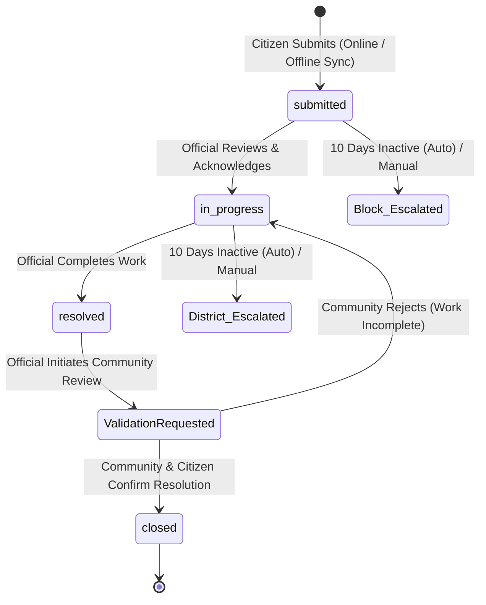

# GramConnect Domain Context & Ubiquitous Language

This document establishes the canonical domain model, bounded contexts, and ubiquitous language for **GramConnect**. All code symbols, API routes, database schemas, and documentation must adhere to these definitions.

---

## 1. Ubiquitous Language

| Term | Domain Meaning | System Representation |
| :--- | :--- | :--- |
| **GramConnect** | The citizen-centric civic governance and grievance management platform. | Application namespace |
| **Citizen** | A registered community resident entitled to submit complaints, track resolution timelines, and participate in peer resolution reviews. | `User` model (`role: "citizen"`) |
| **Official** | A government administrative authority tasked with reviewing, actioning, escalating, and resolving complaints within their jurisdiction. | `Official` model (`role: "official"`) |
| **Designation** | The administrative tier of an official determining geographic and hierarchical scope: `Block`, `District`, `State`, or `Owner`. | `official.designation` |
| **Owner** | The super-administrative designation possessing cross-jurisdictional visibility, system state hash publication rights, and administrative lifecycle control. | `designation: "Owner"` |
| **Complaint** | A formal civic grievance containing an author reference, title, description, category, geographic metadata, optional media attachments, and lifecycle timestamps. | `Complaint` model |
| **Complaint Category** | The civic sector classification: `water`, `roads`, `electricity`, `healthcare`, `education`, or `other`. | `complaint.category` |
| **Lifecycle State** | The progressive workflow state of a complaint: `submitted` $\to$ `in_progress` $\to$ `resolved` $\to$ `closed`. | `complaint.status` |
| **Jurisdictional Level** | The current administrative tier actively responsible for resolving a complaint: `Block` $\to$ `District` $\to$ `State`. | `complaint.currentLevel` |
| **Escalation** | Promotion of an unresolved complaint from a lower administrative tier to a higher tier (manual by official or automated by scheduler). | `complaint.escalationHistory` |
| **Auto-Escalation** | Background cron service executing daily at 02:00 AM, automatically escalating complaints that have lingered at `Block` or `District` level for $\ge 10$ days. | `services/autoEscalation.js` |
| **Community Validation** | Peer-review verification where citizens confirm whether a reported issue was genuinely fixed in the real world before an official can mark it `closed`. | `Validation` model |
| **SystemMeta** | Singleton administrative document tracking system-wide state hashes, version sequence, and cryptographic audit history. | `SystemMeta` model (`_id: "main"`) |
| **Global State Hash** | Deterministic SHA-256 digest computed across all complaints in sorted ID order, used to detect unauthorized database tampering. | `systemMeta.globalHash` |
| **Tamper Detection** | Automated audit routine (30-minute interval) recalculating database hash state and comparing against stored and historical digests. | `utils/tamperDetection.js` |
| **Offline Sync Queue** | Client-side IndexedDB store that captures complaint submissions when disconnected and synchronizes them via Service Worker upon reconnect. | `frontend/src/utils/indexedDB.js` |

---

## 2. Bounded Contexts

```
┌─────────────────────────────────────────────────────────────────────────────┐
│                             GramConnect Platform                            │
├───────────────────────────────────┬─────────────────────────────────────────┤
│    Citizen Experience Context     │        Official Governance Context      │
│  - Multi-modal complaint intake   │  - Jurisdictional complaint triage      │
│  - IDOR-scoped complaint tracking │  - Departmental workflow & dispatch     │
│  - Community peer validation      │  - Hierarchical escalation control      │
├───────────────────────────────────┼─────────────────────────────────────────┤
│       Offline Resilience Context  │        System Integrity Context         │
│  - Service Worker network proxy   │  - Deterministic SHA-256 state hashing  │
│  - IndexedDB durable storage      │  - 30-minute automated tamper audit     │
│  - Background sync reconciliation │  - Historical state comparison & restore│
└───────────────────────────────────┴─────────────────────────────────────────┘
```

### Context A: Citizen Experience
- **Primary Actors**: Citizens.
- **Invariants**:
  - Citizens can only query and mutate complaints authored by their own authenticated identity (`req.user.id`).
  - Passwords and internal state hashes are never projected or transmitted over the wire.
  - Registration defaults to `role: "citizen"`; client role override attempts are discarded.

### Context B: Official Governance & Escalation
- **Primary Actors**: Officials (`Block`, `District`, `State`, `Owner`).
- **Invariants**:
  - Non-Owner officials are restricted strictly to complaints matching their department, administrative level, and geographic boundary.
  - Complaints cannot jump backwards in administrative hierarchy during escalation.
  - Auto-escalation triggers precisely when a complaint has remained at `Block` or `District` without resolution for $\ge 10$ days.

### Context C: System Integrity & Tamper Detection
- **Primary Actors**: Platform Owner, Automated Background Cron.
- **Invariants**:
  - Calculation of global state hash is deterministic: complaints are sorted by `_id`, normalized to a stable schema, and hashed using SHA-256.
  - Updating or publishing a new `globalHash` requires authenticated `Owner` designation.
  - Any mismatch between active database calculations and `SystemMeta` triggers a `TAMPERED` status report.

### Context D: Offline Resilience
- **Primary Actors**: Browser Service Worker, IndexedDB Sync Manager.
- **Invariants**:
  - In offline mode, new complaints receive a local temporary UUID and are persisted in IndexedDB store `offline-complaints`.
  - Upon network reconnection (`navigator.onLine == true`), the sync manager drains the queue via FIFO batch dispatch.

---

## 3. Complaint Lifecycle State Machine


